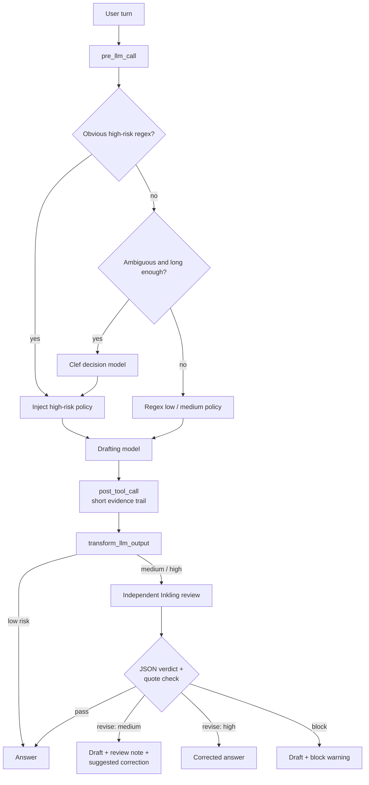

# Risk-Gated Verification

[](https://github.com/BenkoMatt/risk-gated-verification/actions/workflows/tests.yml)

> **Fast models draft. A cheap gate decides when an independent model should check the work.**

Risk-gated verification is a small [Hermes Agent](https://hermes-agent.nousresearch.com/docs) plugin that adds a verification layer to a chat agent without making every turn slow. It classifies each user turn as **low**, **medium**, or **high** risk, injects a matching verification policy, and sends medium/high-risk final replies to a second model for an adversarial review.

The reference deployment uses **DeepSeek V4.1 Flash** as the fast drafter, **Clef** as a low-latency decision model, and **Inkling 2 Small** as the independent verifier. The plugin does not require those exact models; the interfaces are small and replaceable.



## Why this exists

A fast model is useful precisely because it does not spend a long time deliberating. That is also why it can be confidently wrong. Asking the same model “are you sure?” is weak evidence: the second pass shares the first pass's blind spots.

Checking every turn with a stronger model is the other extreme. It doubles the model calls, adds seconds to every reply, and spends most of its budget reviewing casual conversation that nobody needed verified.

Risk-gated verification takes the middle path:

- **Low-risk turns** — casual chat, brainstorming, opinions — bypass the verifier entirely.
- **Medium-risk turns** — facts that move, technical claims, versions, prices, docs — get a targeted policy before drafting and a review after drafting.
- **High-risk turns** — client-facing work, money, legal, security, config, deployments, irreversible actions — get a stricter policy, an adversarial review, and evidence requirements.
- **Tool evidence** gathered during the turn is passed to the verifier, so it can confirm a claim instead of guessing.
- **Verifier failures never erase the answer.** The system fails open.

The design goal is not “verify everything.” It is **spend verification where a wrong answer is expensive**.

## The three tiers

| Tier | Typical trigger | Before drafting | After drafting |
|---|---|---|---|
| **Low** | Casual chat, creative work, opinion, simple internal question | No extra policy | No verifier |
| **Medium** | Current facts, versions, prices, docs, repo contents, technical claims | “Check volatile facts; inspect files before claiming contents; mark what you could not verify.” | Independent review; keep the draft, append issues and a suggested correction |
| **High** | Client-facing, invoices, contracts, pricing, security, credentials, config/gateway changes, deployments, destructive actions | “Verify every externally checkable claim; do not guess; run tests; distinguish verified from assumed; wait for approval on irreversible action.” | Adversarial review; a corrected answer may replace the draft; critical unsupported claims can be blocked |

The tier is a **routing decision**, not a claim about the model's confidence. A low-confidence classifier result is a reason to stay conservative, not a reason to skip verification.

## What makes it different

### Gate verification, not delegation

A decision model should answer **“does this turn need verification?”** — not **“should I spawn a subagent?”** Per-question delegation adds a full model round-trip, serializes context, consumes a concurrency slot, and can still share the maker's blind spot.

The default path is one direct verifier call against the draft and the turn's tool evidence. Delegation is reserved for cases where a separate agent must gather its own evidence, and it is not the default gate.

### The verifier must quote the draft

LLM reviewers sometimes invent a sentence, criticize it, and return a confident-sounding issue. Every issue is therefore required to contain a quoted substring that literally appears in the draft. Issues without a matching quote are dropped. If no issue survives, the review passes.

That one rule converted the verifier from “another opinionated model” into a checker with a falsifiable output contract.

### Medium and high risk are handled asymmetrically

- A **medium-risk** review never replaces the draft. It appends the issues and a suggested correction, so a wrong reviewer cannot silently degrade a good answer.
- A **high-risk** review may replace the draft when it returns an explicit `revise` verdict with a corrected answer.
- A `block` verdict prefixes a visible warning; it does not hide the draft.

### Fail open, always

If the verifier times out, returns malformed JSON, or the decision model is unavailable, the plugin preserves the original answer. A checker failure is not evidence that the answer is wrong. The fallback is the unverified draft plus whatever the agent already knew.

## What is in this repository

| Path | Purpose |
|---|---|
| [`plugin/`](plugin/) | Reference Hermes plugin: manifest, implementation, example config |
| [`docs/how-it-works.md`](docs/how-it-works.md) | Hook-by-hook mechanics and the review contract |
| [`docs/design-rationale.md`](docs/design-rationale.md) | Why the gate is shaped this way, and what was rejected |
| [`docs/implementation-walkthrough.md`](docs/implementation-walkthrough.md) | Build and deploy it from an empty plugin directory |
| [`docs/evaluation-notes.md`](docs/evaluation-notes.md) | Deployment evidence, latency/token notes, and known failure modes |
| [`tests/`](tests/) | Standard-library tests for classification, JSON extraction, and quote checking |

## Quick start

Requirements:

- Hermes Agent with the plugin hook API (`pre_llm_call`, `post_tool_call`, `transform_llm_output`, `pre_verify`)
- An Ollama Cloud key if you use the reference Clef and Inkling endpoints
- Python 3.11+ for the tests

```bash
git clone https://github.com/BenkoMatt/risk-gated-verification.git
cd risk-gated-verification

# The pure logic has no third-party dependencies.
python -m unittest discover -s tests -v
```

Install the reference plugin into one Hermes profile:

```bash
mkdir -p ~/.hermes/plugins
cp -R plugin ~/.hermes/plugins/risk-gated-verification
```

Add the config block from [`plugin/config.example.yaml`](plugin/config.example.yaml) to the profile's `config.yaml`, then verify discovery:

```bash
hermes plugins doctor risk-gated-verification
# manifest: risk-gated-verification 0.1.0
# OK: runtime discovery, manifest parsing, import, and registration passed
# registrations: 0 tool(s), 4 hook(s)
```

Enable it:

```bash
hermes plugins enable risk-gated-verification
hermes plugins list | grep risk-gated
```

Reload after code changes with a disable/enable pair:

```bash
hermes plugins disable risk-gated-verification
hermes plugins enable risk-gated-verification
```

A running session can retain the old prompt/tool wiring. **Start a new chat to verify the behavior.**

## Configuration

```yaml
plugins:
  hook_callback_timeout: 60
  entries:
    risk-gated-verification:
      enabled: true
      llm:
        allow_model_override: true
        allowed_models:
          - inkling-2-small
      settings:
        auto_review: true
        review_medium: true
        review_high: true
        use_decision_model: true
```

| Setting | Default | Meaning |
|---|---:|---|
| `auto_review` | `true` | Run the verifier on medium/high-risk replies |
| `review_medium` | `true` | Review factual/technical medium-risk turns |
| `review_high` | `true` | Review high-consequence turns |
| `use_decision_model` | `true` | Ask Clef about ambiguous turns; regex remains the fallback |

The direct review timeout is 28 seconds; the plugin-level hook budget is 60 seconds. If you use slower verifier models, raise both deliberately and measure the tail latency.

Turn off the extra model calls while keeping the policy injection:

```yaml
settings:
  auto_review: false
```

## How to know it is working

Use one prompt from each tier and inspect the reply plus the session logs:

1. **Low:** `“Give me three names for a coffee shop.”` — no verification note, no extra model call.
2. **Medium:** `“What is the latest stable version of X?”` — the draft is checked; if the verifier finds an unsupported version claim, a **Verification note** and suggested correction follow the answer.
3. **High:** `“Draft the client invoice for last month.”` — a stricter policy is injected; the answer is reviewed adversarially. A corrected answer may replace the draft.

Useful commands:

```bash
hermes plugins doctor risk-gated-verification
hermes plugins list | grep risk-gated
grep "risk-gated-verification" ~/.hermes/logs/gateway.log | tail -n 20
```

Set `RISK_GATE_DEBUG=1` to write a compact debug JSONL trace if you add the optional debug path from the reference implementation.

## Deliberate non-goals

- **It is not a truth oracle.** A pass means “no surviving quoted defect,” not “this is true.” Tools, tests, source documents, and human approval remain authoritative.
- **It does not replace tests.** The `pre_verify` hook nudges for fresh test/lint/build evidence after code edits, but the command output is the evidence.
- **It does not verify every token.** Classification is heuristic; the decision model is a gate, not a proof.
- **It does not send private client material to web search.** The verifier receives the draft and the turn's local tool evidence; retrieval policy is separate.
- **It does not enable the delegated verifier.** That variant was tested, returned prose instead of its JSON contract, and fabricated quotes. The direct review is the reliable path.

## Status

This is a **reference implementation and deployment guide**, extracted from a working Hermes deployment. The core logic is covered by tests; the Hermes-specific plugin bindings are documented against the hook API and may need small changes as Hermes evolves.

The evaluation that motivated the design is summarized in [`docs/evaluation-notes.md`](docs/evaluation-notes.md). The short version: independent review catches unsupported claims, but only when the reviewer is forced to quote the draft and the system fails open.

## License

MIT. See [`LICENSE`](LICENSE).
