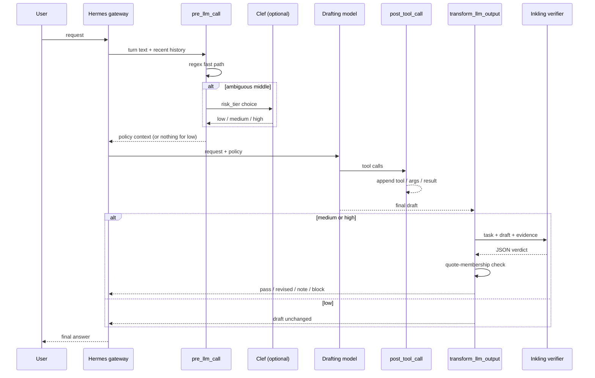

# How it works

Risk-gated verification is a **per-turn control loop**, not a second chatbot. It has four hook points and one small piece of state per session.



## 1. `pre_llm_call`: classify and inject policy

The hook receives the user message, session id, platform, and recent conversation history. It runs a cheap classifier:

1. **High-risk regex first.** Client, invoice, contract, legal, pricing, security, credentials, deploy, production, database, delete, force-push — these are high-consequence even when the user says “just draft it.”
2. **Context resolution.** A short message such as “do it” or “yes” is combined with the last few user/assistant turns. A bare confirmation is low by text but may be high by context.
3. **Clef decision model for the ambiguous middle.** If the turn is not already high, is long enough to contain a real request, and is not a trivial greeting, the plugin asks a typed decision model for `risk_tier`. The call is capped at about three seconds; any failure falls back to the regex result.
4. **Policy injection.** High and medium turns get a compact instruction appended to context. Low turns get nothing.

The policy is deliberately short. It is a reminder of what counts as evidence, not a second essay:

- **Medium:** check volatile facts, inspect local files before claiming contents, mark unverified claims.
- **High:** verify every externally checkable claim, do not guess names/dates/prices/versions/paths/permissions, run tests or dry-runs before claiming success, distinguish verified from assumed, wait for approval on irreversible/client-facing actions.

The hook stores `{risk, message, platform}` for the session so the later output hook knows what tier this turn received. It also clears the evidence list at the start of each turn and bounds the session map so a long-lived gateway does not grow forever.

## 2. `post_tool_call`: collect authoritative evidence

Every tool result is reduced to a bounded record:

```text
[tool_name]
args={...}
result=...
```

Only the last eight records are kept, each truncated. The point is not to archive the turn; it is to give the verifier the same evidence the drafting model actually saw. If a claim was checked with `read_file`, `web_search`, or a test command, the verifier can see that. If no tool was used, it knows the claim is unsupported.

## 3. `transform_llm_output`: independent review

This hook receives the final draft. Low-risk turns return immediately.

For medium and high risk, it builds a verifier prompt with three inputs:

- the original task (bounded),
- the proposed answer (bounded),
- the turn's tool evidence (bounded).

The verifier is instructed to **find defects, not praise**. It must ignore tone, style, emoji, and formatting unless they change meaning. It must not invent sources. It returns JSON only:

```json
{
  "risk": "medium",
  "verdict": "revise",
  "issues": [
    "The answer says \"v0.33.3\" but the provided evidence shows v0.34.1."
  ],
  "corrected_answer": "The current stable version is v0.34.1.",
  "evidence_needed": []
}
```

The schema is intentionally small:

| Field | Meaning |
|---|---|
| `risk` | Echo of the assessed tier |
| `verdict` | `pass`, `revise`, or `block` |
| `issues` | Concrete defects, each tied to quoted draft text |
| `corrected_answer` | Required for `revise`; may be `null` otherwise |
| `evidence_needed` | What the verifier could not check |

### Quote membership

A reviewer can fabricate a quote and then criticize it. Before any issue is accepted, the plugin extracts quoted substrings (double quotes, curly quotes, or backticks) and checks whether the normalized quote appears in the normalized draft.

- No quote → the issue is dropped.
- Quote not present → the issue is dropped.
- At least one quote present → the issue survives.

If every issue is dropped, the verdict is forced to `pass`, the correction is discarded, and no note is appended. This is the single most important guard against verifier theater.

### Verdict handling

| Verdict | Medium | High |
|---|---|---|
| `pass` | Draft unchanged | Draft unchanged |
| `revise` | Draft + review note + suggested correction | Corrected answer replaces the draft |
| `block` | Draft prefixed with a visible warning | Draft prefixed with a visible warning |
| malformed / timeout | Draft unchanged | Draft unchanged |

Medium risk is append-only because a verifier rewrite is not authoritative enough to silently replace a normal answer. High risk may replace because the stakes justify the correction, but it still carries a review note when issues or evidence gaps exist.

## 4. `pre_verify`: ask for fresh evidence after code edits

When the agent has edited code and is about to finish, the hook fires once per turn (not on every retry). If changed paths exist, it asks the agent to run the relevant tests/linter/build and report the exact command and result, or explain why no test applies.

This is a nudge, not a gate. The test output is the evidence; the hook only makes “I changed the code” insufficient on its own.

## State model

The plugin is intentionally in-memory and per-process:

```python
_LAST_RISK: dict[session_id, {risk, message, platform}]
_EVIDENCE:  dict[session_id, list[bounded tool records]]
```

There is no database and no cross-session history. A gateway restart clears the maps; that is acceptable because each new turn reclassifies and rebuilds its own evidence. The risk map is bounded to a few hundred sessions.

## What is optional

- **Clef.** If the decision endpoint is absent, the regex classifier still works. `use_decision_model: false` skips the network call entirely.
- **The exact models.** The reference uses `deepseek-v4.1-flash:1017` for drafting and `inkling-2-small` for verification, but any model exposed through the host's `ctx.llm.complete` interface can be substituted.
- **The exact policy text.** The tiers and the evidence contract matter more than the wording.

## What is deliberately absent

The delegated verifier subagent is **not** part of the reference plugin. It was tested in a real deployment and failed in two ways: the child returned prose instead of the JSON contract, and it fabricated quotes. Direct review with quote checking is simpler, faster, and more reliable. If you need a separate evidence-gathering agent for a high-consequence task, treat that as an explicit workflow with its own timeout and contract, not as the default gate.

## Failure behavior

Every external call is wrapped:

- Clef timeout or malformed choice → regex tier.
- Verifier timeout, HTTP error, or non-JSON → draft unchanged.
- No issues survive quote checking → pass.
- Verifier returns an unrecognized verdict → draft unchanged; append issues only if any survived.

The system never hides an answer because a checker failed. It may return an unverified answer, which is the correct failure mode for an assistant that must remain useful.
